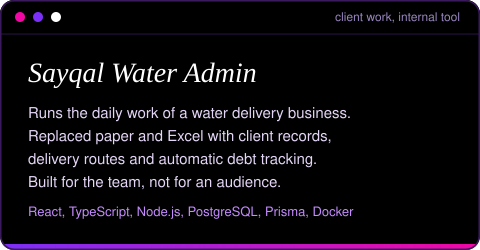
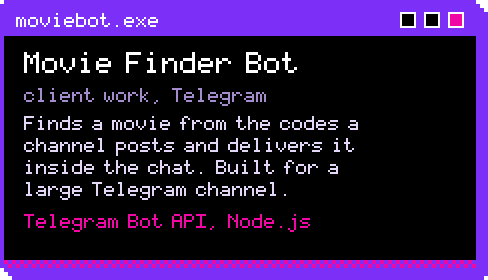
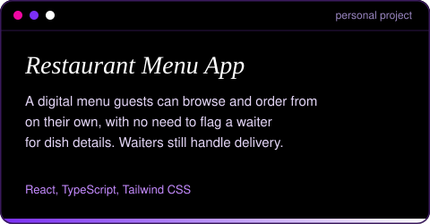
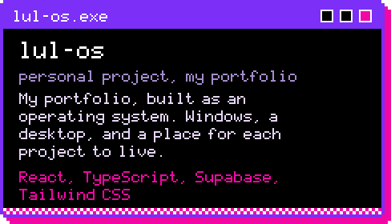
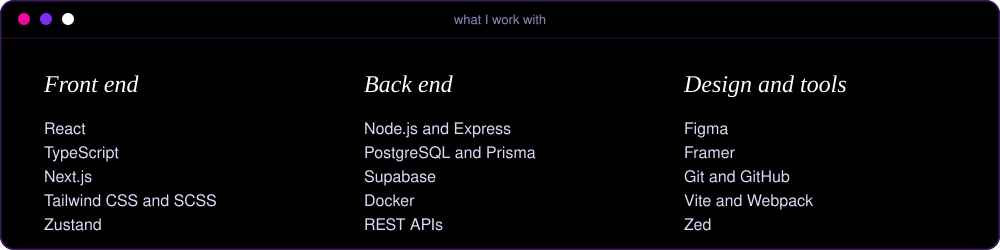

I'm Shahboz, known online as **mrlul**. I'm a front-end developer with two years of experience, working mostly in React and TypeScript. I also build games, mobile apps, and pretty much anything else that runs on a screen.

I care about how a screen feels before how it's built. Outside the editor I draw, design, watch films, and play games. I'm curious about human nature, and it ends up in the interfaces I make.

I keep 20+ other repositories private, so this page shows only a small selection of what I've made.

<!--  -->

## 

<table>
  <tr>
    <td width="50%"></td>
    <td width="50%"></td>
  </tr>
  <tr>
    <td width="50%"></td>
    <td width="50%"></td>
  </tr>
</table>

Also: a [landing page for a consulting company](https://bbb-kappa-liard.vercel.app/) and my [first portfolio, made in Framer](https://mrlul.framer.website/). In total, 15+ projects, 5 of them real-world.

## 

## 

Telegram: [@mrlul_framer](https://t.me/mrlul_framer) 
Email: [shahbozotaganov@gmail.com](mailto:shahbozotaganov@gmail.com) 
LinkedIn: [shahboz-utaganov](https://www.linkedin.com/in/shahboz-utaganov/)

